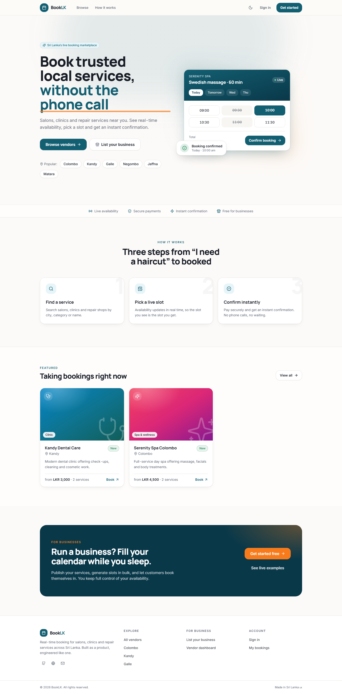
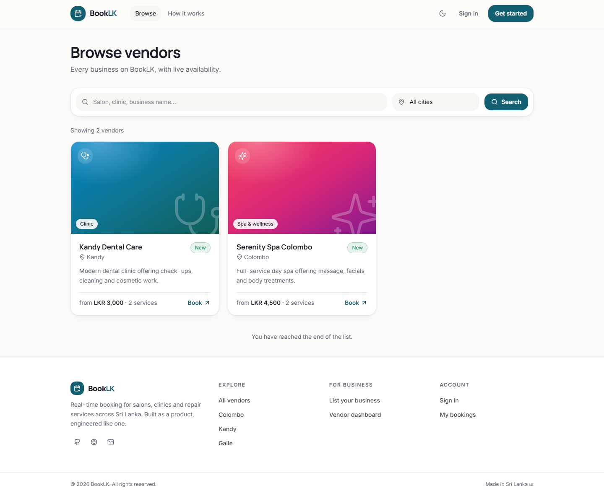
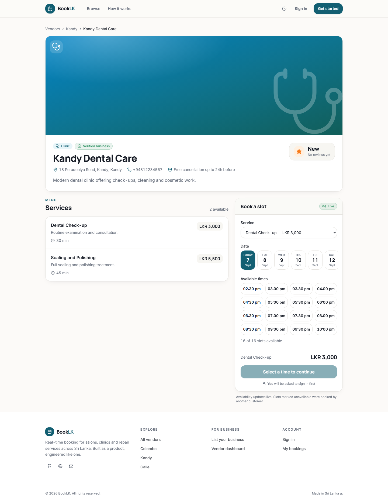
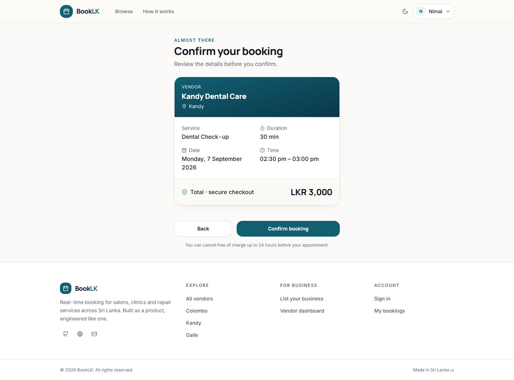
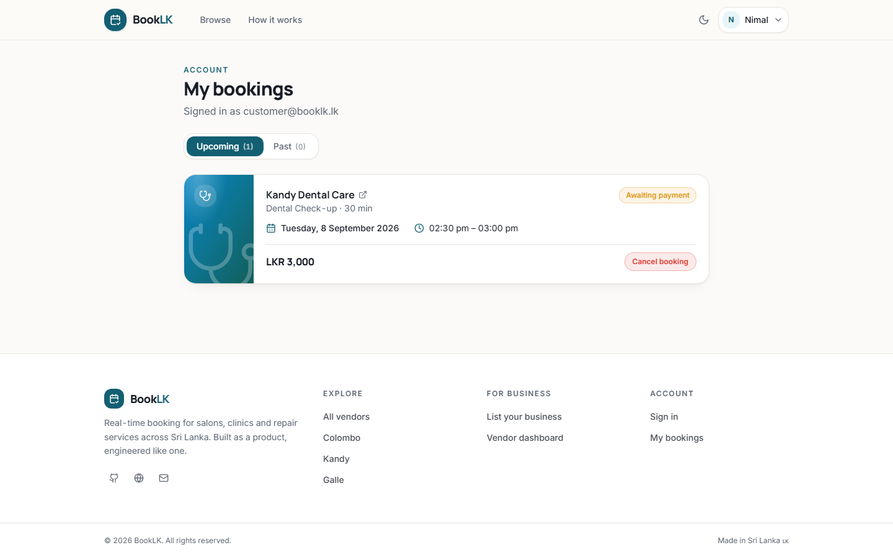
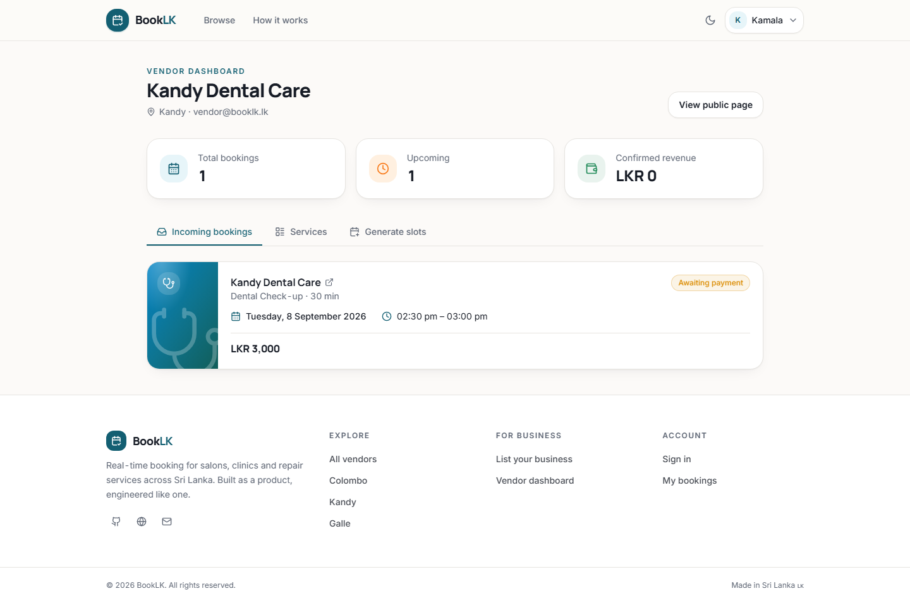
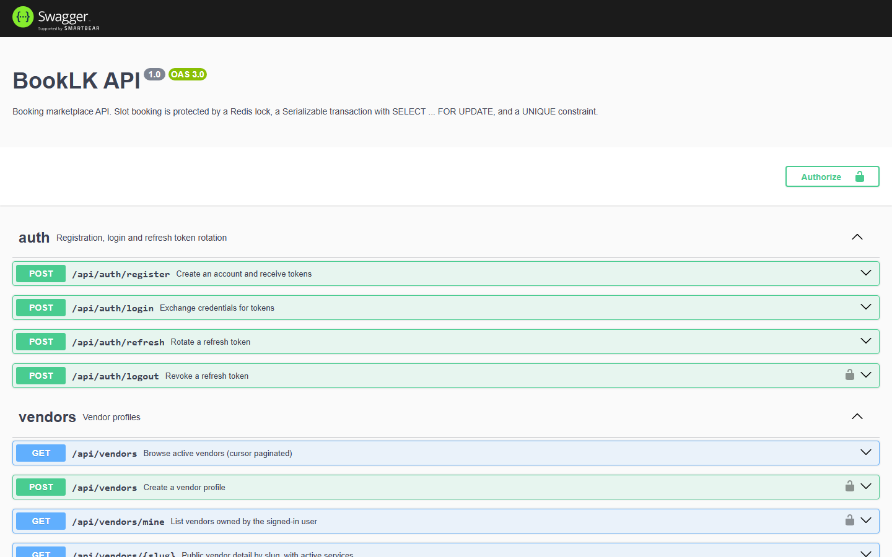
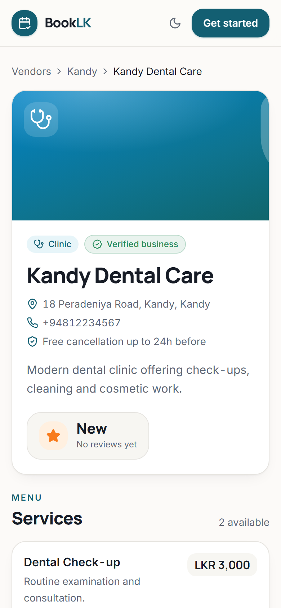
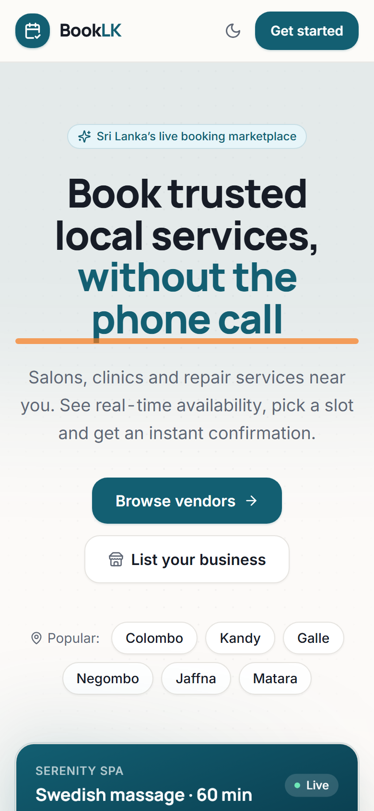

# BookLK — Multi-vendor Booking Marketplace (SaaS) · Showcase

> **This is a public showcase of a private product.** The full source is private (it is being built as a SaaS).
> This repo contains the architecture, database and security design, selected code excerpts, and a demo,
> so that recruiters and clients can evaluate the concept and the engineering quality.
> Full read-only source access can be granted on request for interviews. See [LICENSE](LICENSE).

**Author:** Janindu Gayanga · [iamjanindu.com](https://iamjanindu.com) · [LinkedIn](https://www.linkedin.com/in/janindu-gayanga-02ba60217) · janindugayanga10@gmail.com

---

## What it is

BookLK lets any service business in Sri Lanka (salons, clinics, tutors, vehicle service, studios, sports courts)
publish bookable time slots, take online bookings and payments, and manage customers from one dashboard —
without building their own system. Customers search, book, pay and get real-time updates.

**Live demo:** _coming soon_ · **Demo video (3 min):** _coming soon_

## Features

| Area | What is built |
|---|---|
| Vendors | Onboarding, services & pricing, slot calendar, staff, reviews, analytics |
| Customers | Search & filter, vendor pages (SEO), booking flow, payments, booking history, reviews |
| Bookings | **Double-booking prevention under concurrency** (idempotency key → Redis lock → row lock in Serializable tx → DB unique constraint) |
| Payments | Provider abstraction (multiple gateways behind one interface), HMAC-verified webhooks, idempotent processing |
| Real-time | Go WebSocket service: live slot availability & booking status, Redis pub/sub across nodes |
| Auth & security | JWT access + refresh rotation with reuse detection, RBAC (customer / vendor / admin), rate limiting, CSP, SameSite cookies |
| Platform | Docker Compose, GitHub Actions CI (lint · unit · e2e · `go test -race`), Kubernetes manifests, OpenAPI docs |

## Stack

- **API:** NestJS · TypeScript · Prisma · PostgreSQL · Redis · Swagger/OpenAPI · Jest
- **Real-time:** Go · gorilla/websocket · worker pool · Redis pub/sub · Prometheus metrics
- **Web:** Next.js 14 App Router (SSG / SSR / CSR per route) · TanStack Query · Zustand · Tailwind · lucide-react · PWA · Playwright
- **Infra:** Docker · docker-compose · GitHub Actions · Kubernetes (manifests) · AWS-ready

## Architecture

```
┌──────────┐   HTTPS    ┌───────────────┐   Prisma   ┌────────────┐
│ Next.js  │ ─────────▶ │  NestJS API   │ ─────────▶ │ PostgreSQL │
│  (web)   │            │ (REST/OpenAPI)│            └────────────┘
└────┬─────┘            └──────┬────────┘
     │ WSS                     │ publish (Redis pub/sub)
     ▼                         ▼
┌──────────┐            ┌───────────────┐
│ Go       │ ◀───────── │    Redis      │  (locks, cache, pub/sub)
│ realtime │  subscribe └───────────────┘
└──────────┘
```

Full write-ups: [docs/01-ARCHITECTURE.md](docs/01-ARCHITECTURE.md) · [docs/02-DATABASE.md](docs/02-DATABASE.md) · [docs/03-SECURITY.md](docs/03-SECURITY.md)

## Code excerpts (read-only)

| File | Why it is here |
|---|---|
| [samples/api-bookings/bookings.service.ts](samples/api-bookings/bookings.service.ts) | The booking transaction: idempotency, Redis `SET NX`, `SELECT … FOR UPDATE`, Serializable isolation, unique constraint as last line of defence |
| [samples/api-bookings/bookings.service.spec.ts](samples/api-bookings/bookings.service.spec.ts) | Unit tests for the concurrency paths |
| [samples/realtime-hub/hub.go](samples/realtime-hub/hub.go) | WebSocket hub: goroutine-per-connection, worker pool fan-out, panic/recover, backpressure |
| [samples/realtime-hub/hub_test.go](samples/realtime-hub/hub_test.go) | Race-detector tests for the hub |
| [docs/docker-compose.reference.yml](docs/docker-compose.reference.yml) | How the services are wired locally |

## Screenshots

| | |
|---|---|
| **Home** — SSG landing with featured vendors<br> | **Browse vendors** — cursor-paginated search by city/name<br> |
| **Vendor page** — services + live slot picker (WebSocket "Live" badge)<br> | **Booking confirmation** — idempotent create + payment intent<br> |
| **Customer dashboard** — upcoming/past, cancel<br> | **Vendor dashboard** — incoming bookings, services, slot generator<br> |
| **OpenAPI docs** — every route documented<br> | **Mobile / PWA** — responsive, installable<br>  |

## Status & roadmap

MVP complete (API 38 routes · web 16 routes · realtime service · CI). Next: payments go-live (LankaQR / PayHere), vendor
subscriptions (SaaS billing), multi-tenant custom domains, RAG assistant for vendor FAQs.

## Access to full source

Interviewers / hiring managers: email me and I will add you as a **read-only collaborator** on the private repo for the
duration of the process.
