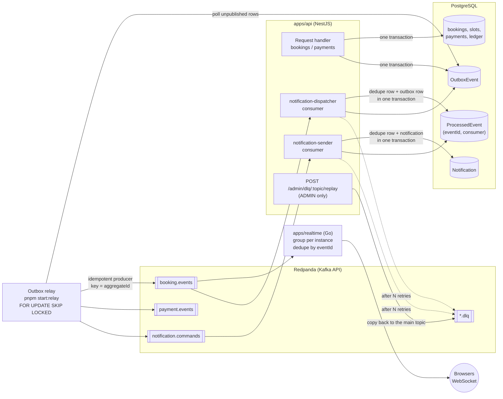
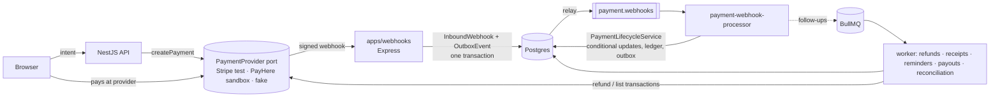

# 01 — Architecture

BookLK is a multi-vendor service booking marketplace. Customers book time slots with
vendors (salons, clinics, repair shops); vendors publish services and availability; the
platform takes a commission on every booking and pays vendors out.

This document explains what each piece is, why it exists, and what was rejected.

---

## 1. System overview

```
                              ┌──────────────────────────┐
                              │        Browser           │
                              │  Next.js 14 App Router   │
                              │  (SSG · SSR · CSR · PWA) │
                              └───┬──────────────────┬───┘
                    HTTPS / JSON  │                  │  WSS
                                  │                  │
              ┌───────────────────▼──────┐    ┌──────▼─────────────────┐
              │      apps/api            │    │    apps/realtime       │
              │      NestJS 10           │    │    Go 1.26             │
              │                          │    │                        │
              │  auth · vendors          │    │  WebSocket hub         │
              │  services · slots        │    │  goroutine per conn    │
              │  bookings · payments     │    │  bounded worker pool   │
              │  reviews · health        │    │  heartbeat ping/pong   │
              │  notification consumers  │    │  kafka-go consumer     │
              │  DLQ admin · Swagger     │    │  /health  /metrics     │
              └────┬──────────────┬──────┘    └────▲──────────┬────────┘
                   │              │                │          │
     Prisma / SQL  │              │ ioredis        │ kafka    │ go-redis
     (state + outbox row          │                │          │
      in ONE transaction)         │                │          │
        ┌──────────▼───────┐   ┌──▼────────────────┼──────────▼────────────┐
        │  PostgreSQL 16   │   │             Redis 7                       │
        │                  │   │  slot short-locks (SET NX EX)             │
        │  users, vendors  │   │  sliding-window rate limit counters       │
        │  services, slots │   │  pub/sub booklk:slots (ephemeral hints)   │
        │  bookings        │   │  read-through cache for hot queries       │
        │  payments        │   └───────────────────────────────────────────┘
        │  ledger_entries  │
        │  OutboxEvent     │──poll──► outbox relay ──► Redpanda (Kafka API)
        │  ProcessedEvent  │          (FOR UPDATE      booking.events
        │  Notification    │           SKIP LOCKED)    payment.events
        └──────────────────┘                           notification.commands
                                                       + <topic>.dlq

        Observability:  Sentry (errors) · Prometheus scrape → Grafana (metrics)
        Delivery:       Docker Compose · GitHub Actions CI · Helm on k3d (local) · ArgoCD
```

The write path and the fan-out path are deliberately separated. **The API owns all state
changes. The realtime service owns none.** The realtime service never writes to Postgres;
it is a read-only broadcaster. That single rule is what keeps the split honest, and it is
the first thing to say when someone asks why there are two backend services.

---

## 2. The services, and why each one exists

### apps/api — NestJS + TypeScript + Prisma + PostgreSQL + Redis

The system of record. Everything that changes state goes through here.

| Module | Responsibility | Why it is its own module |
|---|---|---|
| `auth` | Register, login, refresh rotation, RBAC guards | Security surface concentrated in one reviewable place |
| `vendors` | Vendor profile, onboarding, working hours | Tenant root — nearly every other row hangs off `vendor_id` |
| `services` | What a vendor sells: name, duration, price | Price and duration drive slot generation and money maths |
| `slots` | Availability generation and the slot state machine | The contended resource; concurrency lives here |
| `bookings` | Reserve a slot, cancel, the transaction boundary | The one place double-booking can happen |
| `payments` | Mock provider, webhooks, ledger, payout queue | Money code should be isolated and heavily tested |
| `reviews` | Post-completion ratings | Different consistency needs from bookings |
| `health` | Liveness/readiness with dependency checks | Kubernetes and load balancers need a real answer |
| `events` | Outbox writes, relay, Kafka client, idempotent consumer runner, DLQ admin API | The delivery guarantees live in one place; feature modules only call `outbox.enqueue(tx, …)` |
| `notifications` | First real consumers: booking events → notification commands → Notification rows | Shows the consumer pattern end to end, and is where an email/SMS provider plugs in |

NestJS gives module boundaries, dependency injection, guards/interceptors/pipes as
first-class concepts, and decorator-driven Swagger. On a project whose selling point is
that the structure is defensible, an opinionated framework is an asset: the shape of the
code is the same shape you draw on a whiteboard.

### apps/realtime — Go

One job: hold tens of thousands of idle WebSocket connections and push slot changes to
whoever is watching.

Why not just add a NestJS WebSocket gateway and delete this service? Because the
workloads are genuinely different:

- A booking request is short-lived, CPU-light, IO-bound, and needs a transaction.
- A WebSocket connection is long-lived, mostly idle, and costs memory, not CPU.

Node holds idle sockets fine, but every connection's callbacks share one event loop with
the request handlers. A slow JSON serialisation in the fan-out path adds latency to
booking requests. Go's scheduler gives each connection its own goroutine (a few KB of
stack, multiplexed onto OS threads) and the runtime preempts them, so one heavy consumer
does not stall the others. Deploy sizing also decouples: a traffic spike on bookings
means "more API pods"; a marketing push that has people staring at an availability page
means "more realtime pods".

The honest secondary reason: this project exists partly to demonstrate Go concurrency
competence. That is a legitimate reason to pick a stack in a portfolio project, and
saying so plainly in an interview reads better than inventing a performance story.

### apps/web — Next.js 14 App Router

One frontend, three rendering strategies chosen per page by what the page actually needs:

| Page | Strategy | Why |
|---|---|---|
| Landing, category pages | SSG | Content changes rarely, SEO matters, cache at the CDN edge |
| Vendor detail / listing | SSR | Needs fresh availability at load, still must be crawlable |
| Customer + vendor dashboards | CSR | Behind auth, no SEO value, highly interactive |

State is split on the same principle. **TanStack Query owns server state** (bookings,
slots, vendors — data that lives elsewhere and can go stale). **Zustand owns client
state** (booking wizard step, filter panel open, selected slot before submit — data that
has no server truth). The common mistake this avoids is putting server data in a global
store and then hand-writing cache invalidation, refetch-on-focus, and retry logic that
TanStack Query already implements.

Auth in the browser: the access token is held **in memory only** (a module variable, not
`localStorage`) and the refresh token lives in an `httpOnly` cookie the JS cannot read.
XSS therefore cannot exfiltrate a long-lived credential; the worst it can steal is a
token that dies in 15 minutes. See `03-SECURITY.md`.

### Infrastructure

- **PostgreSQL 16** — bookings, money, users. Anything needing transactions or joins.
- **Redis 7** — short slot locks, rate-limit counters, ephemeral pub/sub hints, hot-query cache.
- **Redpanda** (Kafka API) — durable domain events: `booking.events`, `payment.events`,
  `payment.webhooks`, `notification.commands`, each with a `.dlq`. Fed only by the transactional outbox.
- **BullMQ** on the same Redis — refunds, receipt PDFs, reminders, daily payouts, nightly
  reconciliation, run by the worker process (`dist/worker.js`). Bull Board at `/admin/queues`.
- **Docker Compose** for local dev (`--profile events` adds Redpanda + Console),
  Dockerfiles per service, GitHub Actions for CI. Kubernetes runs from the Helm chart in
  `deploy/helm/booklk` (tested on a local k3d cluster). Prometheus metrics (API, relay,
  Go hub), a Grafana dashboard and optional Sentry are in place (Phase 5).

---

## 3. Request lifecycle — a booking, click to confirmed

The single most likely thing you will be asked to walk through. Follow the numbers.

```
 Browser                API (NestJS)             Redis            Postgres        Realtime
    │                        │                     │                  │              │
 1  │ POST /bookings ───────►│                     │                  │              │
    │  Idempotency-Key: k    │                     │                  │              │
    │  Bearer <access JWT>   │                     │                  │              │
    │                        │                     │                  │              │
 2  │              JwtAuthGuard: verify sig, exp   │                  │              │
 3  │              RolesGuard: role == customer    │                  │              │
 4  │              ValidationPipe: DTO + whitelist │                  │              │
 5  │              RateLimitGuard ────────────────►│ INCR window key  │              │
    │                        │◄──── count ok ──────│                  │              │
 6  │              Idempotency: SELECT booking WHERE idempotencyKey=k ►│              │
    │                        │  found? ───────────► return that booking, STOP        │
 7  │              Slot lock: SET lock:slot:<id> <token> EX 10 NX     │              │
    │                        │  not acquired? ────► 409 slot busy, STOP              │
    │                        │                     │                  │              │
 8  │              BEGIN ISOLATION LEVEL READ COMMITTED ─────────────►│              │
 9  │              SELECT * FROM slots WHERE id=$1 FOR UPDATE ───────►│              │
10  │              status must be FREE, else ROLLBACK → 409           │              │
11  │              UPDATE slots SET status='BOOKED' ─────────────────►│              │
12  │              INSERT bookings (... activeSlotId UNIQUE) ────────►│              │
13  │              INSERT "OutboxEvent" booking.created.v1 ──────────►│              │
14  │              COMMIT  (booking + slot + event, all or nothing) ─►│              │
    │                        │                     │                  │              │
15  │  Release slot lock (DEL) — or let the 10s TTL expire            │              │
16  │◄─ 201 Created ─────────│                     │                  │              │
    │                        │                     │                  │              │
17  │        outbox relay: claim row FOR UPDATE SKIP LOCKED ◄────────│              │
18  │        produce to Kafka booking.events (key = bookingId) ──────────────────────►│
19  │        mark publishedAt, COMMIT ───────────────────────────────►│   dedupe,
    │                        │                     │                  │   push to all
20  │◄══════════ WS: {type:"slot.updated", status:"BOOKED", version} ════ watchers ═╡
```

Points worth narrating out loud:

- **Steps 7 and 9 are two different locks, on purpose.** The Redis lock is a cheap
  first-line filter that rejects the 49 losers of a 50-way race before they ever touch a
  database connection. It is *not* the correctness guarantee — Redis locks can be lost to
  network partitions and clock skew. The `SELECT ... FOR UPDATE` inside the READ COMMITTED
  transaction is the correctness guarantee, and the `UNIQUE` constraint on
  `Booking.activeSlotId` is the last line of defence that turns any remaining bug into a
  constraint violation instead of a double-booked customer.
- **The event is a row in the same transaction (step 13), not a publish.** Publishing
  from the handler is a dual write: publish before COMMIT and you can announce a booking
  that rolls back; publish after COMMIT and a crash in between loses the event. The
  outbox removes both failure modes: the event exists if and only if the booking does.
  The relay (steps 17-19) delivers it at least once, so a relay crash after step 18 can
  produce a duplicate, and every consumer dedupes on `eventId`. See
  [ADR 0001](https://github.com/jani358/BookLK/blob/main/docs/adr/0001-outbox-over-dual-writes.md).
- **Step 6 makes the whole endpoint safe to retry.** The idempotency key is a UNIQUE
  column on `Booking` in Postgres, not a Redis entry. A mobile client that times out at
  step 14 and retries with the same key gets the existing booking, not a second one; two
  first attempts racing with one key cannot both insert, because the second hits the
  unique index.
- **Why READ COMMITTED, not Serializable.** Every row the transaction decides on is
  locked explicitly (the slot by `FOR UPDATE`, the booking by `UNIQUE(activeSlotId)`).
  Serializable was used at first, and the k6 spike showed it aborting bookings for
  *different* slots and leaving slots unsold; see the
  [ADR 0002 update](https://github.com/jani358/BookLK/blob/main/docs/adr/0002-active-slot-uniqueness.md) and
  [LOAD-TEST-REPORT](https://github.com/jani358/BookLK/blob/main/docs/LOAD-TEST-REPORT.md).

---

## 4. Event flow: outbox → Kafka → consumers

Every booking and payment state change emits a versioned event (`booking.created.v1`,
`booking.confirmed.v1`, `booking.cancelled.v1`, `booking.completed.v1`,
`payment.initiated.v1`, `payment.succeeded.v1`, `payment.failed.v1`,
`payment.refunded.v1`). The schemas are zod definitions in
`apps/api/src/events/schemas.ts`; each envelope carries `eventId`, `type`, `version`,
`occurredAt`, `aggregateType`, `aggregateId` and a typed `data` body.



### The pieces

| Piece | Where | What it guarantees |
|---|---|---|
| Outbox write | `OutboxService.enqueue(tx, …)` inside the booking / payment transaction | The event exists if and only if the state change committed. The method only accepts a transaction client, so "publish outside the transaction" cannot be written by accident. Bodies are validated with zod at write time, so a bad event fails its own request instead of poisoning consumers. |
| Relay | `OutboxRelayService`, run in-process (`OUTBOX_RELAY_ENABLED=true`) or standalone (`pnpm start:relay`) | One Postgres transaction per batch: claim rows `FOR UPDATE SKIP LOCKED`, produce with acks=all, then mark `publishedAt`. A crash before the produce loses nothing; a crash after it re-publishes the batch (at-least-once). Failed batches back off exponentially (`attempts`, `lastError`, `nextAttemptAt`). Only the OLDEST unpublished event of each aggregate is eligible, so per-aggregate order survives retries and multiple relay replicas. |
| Kafka | `booking.events` / `payment.events` / `notification.commands` (3 partitions) + `.dlq` (1) | Messages are keyed by aggregate id, so one booking's events stay ordered on one partition. Topics are created by the compose init container and, idempotently, by the API on boot. |
| Idempotent consumers | `IdempotentEventProcessor` + `EventConsumerService` (one KafkaJS consumer group per handler) | The handler runs inside a transaction that also inserts `(eventId, consumer)` into `ProcessedEvent` with `ON CONFLICT DO NOTHING`. Its writes therefore happen once per consumer, however often the event is delivered. Failures retry with backoff, then go to `<topic>.dlq` with error metadata headers. |
| DLQ replay | `POST /api/admin/dlq/:topic/replay` (admin), `GET /api/admin/dlq/:topic` | Copies parked messages back to their original topic. The consumer that failed processes them; the ones that already succeeded skip them through dedupe. Progress is a committed offset, so each message is replayed once. |
| Realtime hub | `apps/realtime/internal/consumer` (kafka-go) | Maps `booking.created/confirmed` to `slot.updated BOOKED` and `booking.cancelled` to `FREE`. Dedupes by `eventId` in a bounded LRU, and drops updates whose slot version is older than one already pushed (events of different bookings for the same slot can arrive out of order). |

The first real consumer pair is notifications: `booking.confirmed` / `booking.cancelled` →
**notification-dispatcher** writes one `notification.send.v1` command per recipient
(customer + vendor owner) through the outbox, inside its own dedupe transaction →
**notification-sender** records a `Notification` row (listed at `GET /api/notifications`)
and logs it. A real email/SMS provider plugs in there.

### Realtime fan-out inside the Go service

```
Kafka booking.events ──► kafka-go reader (group booklk-realtime-<hostname>)
                              │ decode envelope, dedupe eventId, slot-version guard
                              ▼
Redis booklk:slots ──► subscribe loop ──► bounded worker pool (N=16)
                              │
                              ▼  hub.Broadcast("vendor:<vendorId>")
                        hub: room → []*Client ──► writePump per client ══ WS frame ══► browser
                                                                   queryClient.setQueryData()
```

Design points:

- **One consumer group per realtime instance, not one shared group.** WebSockets are
  sticky: the people watching vendor X are spread over every pod. A shared group would
  split partitions between pods and each pod would see only some bookings. The default
  group id is `booklk-realtime-<hostname>`, and a new group starts at the end of the
  topic, because clients fetch current availability over REST when they connect.
- **Why Redis pub/sub is still there.** Booking state is a durable domain event, so it moved
  to Kafka: a realtime pod that restarts now resumes from its committed offset instead of
  silently missing updates. The `booklk:slots` channel stays for *ephemeral* signals that
  are not domain events and need no durability or replay: short checkout holds, the
  expired-hold sweeper, and operator tooling (`cmd/wsprobe`, `redis-cli PUBLISH`). Losing
  one of those costs seconds of stale UI, so fire-and-forget delivery is the cheaper,
  correct tool.
- **Dedupe in memory is enough here.** The hub changes no state; a duplicate that slips
  past the LRU (after a restart) only re-sends a status the browser already shows.
  Consumers that write data (notifications) dedupe durably in Postgres instead.
- **Bounded worker pool, not `go func()` per message.** An unbounded spawn turns a burst
  into an OOM. A bounded pool with a bounded queue converts overload into *dropped
  messages plus a metric*, which is survivable: the UI is stale for a few seconds and
  self-heals on the next fetch.
- **Per-client buffered send channel with a slow-consumer policy.** If a client's buffer
  (`SEND_BUFFER_SIZE`, default 256) fills, that client is closed rather than allowed to
  block the hub.
- **The frontend patches the cache, it does not refetch.** The WS hook calls
  `queryClient.setQueryData` for the affected slot, so one booking does not become a
  thundering herd of HTTP requests from every watcher.
- **Metrics.** `/metrics` exports `booklk_realtime_kafka_messages_{consumed,duplicate,stale,ignored,invalid}_total`,
  `booklk_realtime_kafka_errors_total` and the `booklk_realtime_kafka_consumer_lag` gauge,
  next to the existing connection and drop counters. The API's `/health` reports the
  outbox backlog (`pending`, `oldestPendingSeconds`) without failing the probe.

---

## 4b. Payments: providers, webhooks, jobs, reconciliation (Phase 2)



- **Provider port.** `src/payments/domain/payment-provider.port.ts`; adapters for Stripe
  (test keys only), PayHere (sandbox only) and a deterministic fake (default, used by tests).
- **Webhooks** are verified and recorded by `apps/webhooks`, never processed inline; the
  consumer applies them through the same idempotent lifecycle step as the fake endpoint.
- **Money rules** are pure functions: integer basis-point commission, proportional refund
  allocation, ledger lines and summaries, reconciliation.
- **Refunds** are rows executed by a job, completed with reversal entries and a vendor
  clawback; the ledger cannot be updated (trigger).
- **Jobs** treat Postgres as the truth: they re-read their row, use deterministic ids,
  and sweepers rebuild lost work. Payout batches net payouts and clawbacks per vendor.
- **Reconciliation** runs nightly and turns any disagreement between provider, payment and
  ledger into one issue plus an admin alert; a missing webhook can be healed.

Decisions: [ADR 0002](https://github.com/jani358/BookLK/blob/main/docs/adr/0002-active-slot-uniqueness.md) ·
[0003](https://github.com/jani358/BookLK/blob/main/docs/adr/0003-payment-providers-and-webhooks-service.md) ·
[0004](https://github.com/jani358/BookLK/blob/main/docs/adr/0004-refunds-as-ledger-reversals.md) ·
[0005](https://github.com/jani358/BookLK/blob/main/docs/adr/0005-bullmq-jobs-and-nightly-reconciliation.md).

## 5. Why three services instead of a monolith

The honest answer has two halves, and giving both is what makes it credible.

**The case for the split as built:**

| Reason | Substance |
|---|---|
| Different resource profiles | Idle WebSockets cost memory; bookings cost DB connections and CPU. Scaling them together wastes one to satisfy the other. |
| Failure isolation | A panic in a connection handler must not take down payment processing. Separate processes make that structural rather than a matter of care. |
| Independent deploy cadence | Frontend ships several times a day; the money path ships rarely and carefully. |
| Right tool per job | Go for many idle connections, NestJS/Prisma for transactional business logic, Next.js for a rendering-flexible UI. |

**When a monolith would have been the better call — and mostly is:**

At BookLK's actual current scale (a handful of vendors, no real traffic), a single NestJS
app with a WebSocket gateway would be strictly better. The distributed version buys costs
you pay from day one:

- Three deploy pipelines, three Dockerfiles, three health checks, three log streams.
- A shared `JWT_SECRET` that two codebases in two languages must agree on — a real class
  of "works locally, 401s in prod" bugs.
- No cross-service transaction. The dual-write gap needs an outbox, a relay and
  idempotent consumers (§4) — machinery a monolith calling functions in-process would
  not need.
- Local development needs everything running to test anything end to end.
- Debugging a booking now spans two languages and a message bus.

The rule I would actually apply on a commercial team: **start as a modular monolith with
clean module boundaries, and extract a service only when a specific, measured pressure
demands it** — this component needs to scale differently, or needs a different runtime,
or its failures are hurting an unrelated feature. BookLK extracted the realtime service
*before* that pressure arrived, and the deciding factor was demonstrating the skill, not
a production bottleneck. The module boundaries inside `apps/api` are drawn so that
extraction stays cheap if pressure ever does arrive — which is the part of the design I
would defend on a real team.

---

## 6. Technology choice rationale

| Choice | Why | What it costs / what was rejected |
|---|---|---|
| **NestJS** over Express | DI, module boundaries, guards/pipes/interceptors, decorator-driven Swagger. Structure that survives a growing team. | Heavier and more opinionated; decorators and DI are a real learning curve. **Rejected:** bare Express (structure becomes a matter of discipline), Fastify (faster, thinner ecosystem for this), Spring Boot (right for a Java shop, wrong for a TS-first stack). |
| **TypeScript** across JS-land | One language for API and web; Prisma generates types from the schema so a column rename fails at compile time. | Build step, occasional type gymnastics. |
| **Prisma** over TypeORM/Knex | Schema-first with a real migration workflow, generated types, readable queries. `$transaction` with an explicit isolation level covers the booking path. | Less control over exotic SQL — raw SQL is used deliberately for `SELECT ... FOR UPDATE`. **Rejected:** TypeORM (entity/migration drift), raw `pg` (fast, but hand-maintained types). |
| **Go** for realtime | Goroutine per connection at a few KB each; the runtime preempts, so one bad consumer cannot stall others; static binary in a tiny container; `defer`/`recover` gives per-goroutine crash containment. | A second language, second toolchain, second CI job. **Rejected:** Node WS gateway (shares the event loop with bookings), Elixir/Phoenix (arguably better at this, but a third language nobody on the team reads), managed Pusher/Ably (removes the interesting engineering, adds per-message cost). |
| **PostgreSQL** for the core | Bookings and money need ACID, row locks, `SERIALIZABLE`, unique constraints, and joins. The double-booking guarantee is *built from* Postgres primitives. | Vertical-scaling-first; sharding is a project. **Rejected:** MySQL (fine, weaker constraint/type story), any document store for bookings (no multi-row transactional guarantee = the exact bug we are preventing). |
| **MongoDB** for reviews / activity logs | Review documents are shape-flexible (photos, vendor replies, moderation flags), append-heavy, never join against money rows, and tolerate eventual consistency. | A second database to operate, back up, and monitor. **This is the weakest justification in the stack, and I would say so in an interview:** Postgres `JSONB` would serve reviews well and remove an entire dependency. Mongo is here because polyglot persistence with a *stated* boundary — transactional core in Postgres, flexible non-transactional content in Mongo — is a defensible pattern, not because reviews outgrew Postgres. |
| **Redis** for locks, limits, cache, pub/sub | Single-threaded atomic ops make `SET NX EX` a correct short lock; sliding-window counters are cheap; pub/sub gives cross-instance fan-out; TTLs make expiry free. | Not durable — anything in Redis must be reconstructible from Postgres. Redis locks are an optimisation, never the correctness guarantee. |
| **Kafka events via a transactional outbox** (`booking.created.v1`, `payment.succeeded.v1`; Redpanda locally) | Booking completion has a growing tail of side effects: notify customer, notify vendor, queue the payout, update analytics, warm search. Doing them inline makes booking slower and couples its success to an email provider's uptime. An append-only log gives durable, replayable, independently-consumable events. | Real operational weight (brokers, consumer groups, lag monitoring, at-least-once so every consumer must be idempotent). **Honest position:** at current scale Redis Streams or BullMQ delivers 90% of the value at 10% of the cost, and that is what a real team should start with. Kafka's advantage is replay — a new analytics consumer can rebuild from the beginning of the log — and *that* is the argument that justifies it later, not throughput. |
| **Next.js App Router** | Per-page SSG/SSR/CSR, file routing, image optimisation, one deployable frontend. | The server/client component split is genuinely confusing at first; `"use client"` boundaries need care. **Rejected:** plain React SPA (no SEO for vendor pages, which is the acquisition channel for a marketplace). |
| **Money as integer cents** | Floats cannot represent 0.1 exactly; commission splits accumulate error; auditors do not accept "off by a cent". | Every boundary must convert deliberately. See `02-DATABASE.md` §6. |

---

## 7. Trade-offs consciously rejected

- **Redlock across multiple Redis nodes.** Extra complexity for a lock that is explicitly
  only a first-line filter. If the DB transaction is the real guarantee, a fancier
  distributed lock buys nothing.
- **Optimistic locking (version column) for the booking write.** Viable, and cheaper
  under low contention. Rejected because the contended case here is *popular slot, many
  simultaneous attempts* — precisely where optimistic locking degenerates into a retry
  storm. See `06-INTERVIEW-GUIDE.md` §5 for the full comparison; the point is that this
  was a choice with a reason, not a default.
- **`SERIALIZABLE` for every transaction.** Serialisation failures force retries and cost
  throughput. The booking path started at Serializable and was moved to `READ COMMITTED`
  after the load test (explicit locks already give the guarantee). Serializable is kept
  only where a transaction reads rows it does not lock, such as the payment webhook gate
  in `payments.service.ts`.
- **Event sourcing the whole domain.** The ledger is append-only because money genuinely
  needs an audit trail. Making *everything* an event stream would be a large complexity
  bill for one narrow benefit.
- **GraphQL for everything.** REST + Swagger stays the API for every write and every
  authenticated read: faster to build, cacheable, and easy to rate-limit per endpoint.
  GraphQL was added later only for the public catalog reads, with cost limits and
  persisted queries ([ADR 0007](https://github.com/jani358/BookLK/blob/main/docs/adr/0007-graphql-for-public-reads.md)).
- **A service mesh.** Three services do not need mTLS sidecars, traffic shifting, and a
  control plane. That is complexity looking for a problem.

---

## 8. Where this architecture breaks

Stated plainly, because knowing the limits is the point.

| Pressure | First thing to break | Fix |
|---|---|---|
| Write throughput on one hot vendor | Row-lock contention on that vendor's slots | Contention is per-slot, not per-vendor, so this scales further than it looks. Beyond that: shard by vendor. |
| Total connections | Realtime memory before CPU | Horizontal scale; the hub is stateless apart from its own connections. |
| Read traffic on availability | Postgres read IOPS | Redis read-through cache with pub/sub invalidation, then read replicas. |
| Ledger table size | Query time on unindexed date ranges | Partition `ledger_entries` by month; archive cold partitions. |
| Postgres single-writer | Write ceiling | The genuine wall. Vertical scaling first, then shard by `vendor_id` — which is why `vendor_id` is on nearly every table from day one. |

Thresholds and the full scaling path are in `05-SAAS-MODEL.md` §7.
